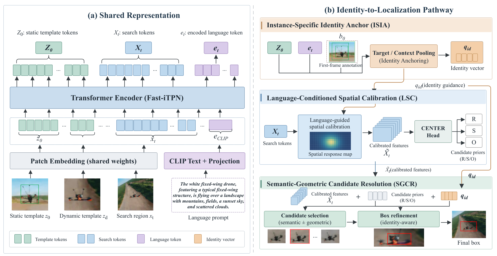
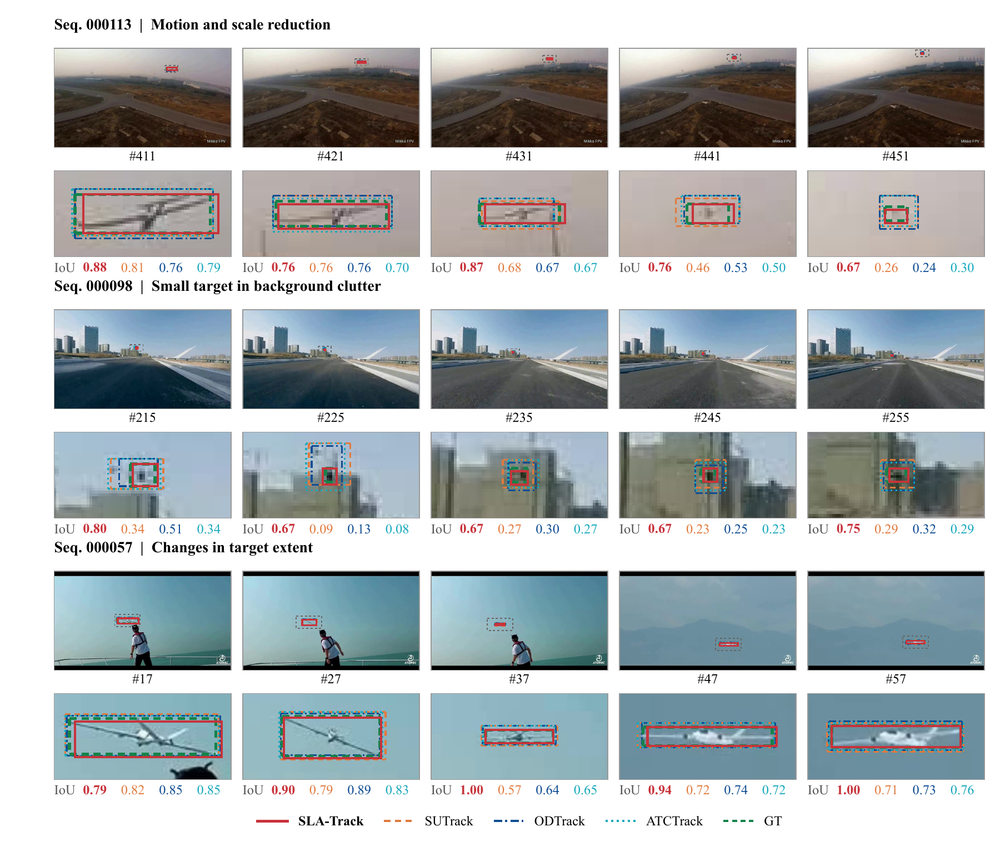

<div align="center">

# SLA-Track

### Beyond Confidence: Identity-Grounded Localization<br>for Dual-Dynamic Anti-UAV Tracking

**Mingjie Zhang · Yongxu Zhou · Kai Chen · Xiangyin Zhang**

[](https://github.com/MingJ-Zhang/UAV-Anti-UAV/actions/workflows/checks.yml)


[](LICENSE)

**Instance identity, carried all the way to the final box.**

[Overview](#overview) · [Results](#results) · [Demo Videos](#demo-videos) · [Quick Start](#quick-start) · [Training](docs/training.md) · [Evaluation](docs/evaluation.md) · [Citation](#citation)

</div>

---

SLA-Track is a vision-language tracker for anti-UAV tracking with simultaneous observer and target motion. It grounds the tracked instance in the first-frame annotation, projects that identity into the current search region, and uses it to select and refine the final target box.

This repository contains the official PyTorch implementation, including the model, training objectives, dataset adapters, online tracker, and benchmark evaluation tools.

## Overview

<p align="center">
  
</p>

The identity-to-localization pathway has three stages:

| Stage | Module | Role |
|:--|:--|:--|
| **Anchor** | **ISIA** — Instance-Specific Identity Anchor | Fuse first-frame target, surrounding context, and language into an instance reference. |
| **Calibrate** | **LSC** — Language-Conditioned Spatial Calibration | Turn the identity reference into a spatial field that calibrates search features before localization. |
| **Resolve** | **SGCR** — Semantic-Geometric Candidate Resolution | Combine native and semantic candidates, compare distractor-relative evidence, and refine the selected box. |

Built on **SUTrack-B224**, SLA-Track uses a Fast-iTPN visual encoder, CLIP text features, a CENTER localization head, and **748,166 additional parameters**. The identity pathway participates in every tracking step.

## Results

Paper results on the official test splits. All metrics use a 0–1 scale; higher is better. A2A-UAV-Tracking and DUT Anti-UAV are evaluated through zero-shot transfer from UAV-Anti-UAV.

| Benchmark | Tracker | Success | Prec@20 | NP AUC | SR@0.5 |
|:--|:--|--:|--:|--:|--:|
| UAV-Anti-UAV | SUTrack | 0.4185 | 0.5759 | 0.4734 | 0.5169 |
| | **SLA-Track** | **0.4670** | **0.6468** | **0.5210** | **0.5757** |
| A2A-UAV-Tracking | SUTrack | 0.7836 | 0.9820 | 0.8751 | 0.9703 |
| | **SLA-Track** | **0.8053** | **0.9884** | **0.8813** | **0.9794** |
| DUT Anti-UAV | SUTrack | 0.6758 | 0.8826 | 0.7541 | 0.8670 |
| | **SLA-Track** | **0.6879** | **0.8919** | **0.7669** | **0.8803** |

**+4.85 / +2.17 / +1.21 percentage points in Success** over the fine-tuned SUTrack baseline across the three benchmarks. SLA-Track ranks first across all four metrics among the fifteen trackers evaluated in the paper.

**43.8 FPS** on an NVIDIA RTX 3090, with **213.84M parameters** and **30.45G MACs** per tracking step; timing uses FP32, batch size 1.

<p align="center">
  
</p>

## Demo Videos

- [UAV-Anti-UAV Test 000212 — labeled video](assets/videos/UAV-Anti-UAV_Test_000212_labeled.mp4)
- [Additional demo video](assets/videos/3c2eb9230949d71be8f94894efd6b464.mp4)

## Quick Start

### 1. Install

```bash
git clone https://github.com/MingJ-Zhang/UAV-Anti-UAV.git
cd UAV-Anti-UAV

conda create -n sla-track python=3.10 -y
conda activate sla-track
python -m pip install torch==2.4.0 torchvision==0.19.0 --index-url https://download.pytorch.org/whl/cu121
python -m pip install -r requirements.txt
```

The CUDA 12.1 command above installs the GPU runtime. A Conda environment specification is also provided in [environment.yml](environment.yml).

### 2. Configure data and weights

```bash
python tools/setup_paths.py --data-dir /path/to/datasets --save-dir outputs
```

Use `--uavanti-root`, `--a2a-root`, `--dut-images`, and `--dut-gt` to set individual dataset locations. See [Data Preparation](docs/data.md) for directory layouts and language inputs.

Place the initialization weights in `pretrained/`:

```text
pretrained/
├── fast_itpn_base_clipl_e1600.pt
└── SUTRACK_ep0180.pth.tar
```

Download sources and checkpoint usage are described in [Weights](docs/weights.md).

### 3. Check the modules

```bash
python tools/sla_v3_unit_test.py
python -m unittest discover -s tests -v
```

The module check exercises identity anchoring, spatial calibration, candidate selection, bounding-box refinement, and gradient flow on CPU.

### 4. Train

```bash
CUDA_VISIBLE_DEVICES=0 python tracking/train.py \
  --config sutrack_b224_sla_v3_uavanti \
  --save_dir outputs --mode single --seed 42
```

The main configuration uses **40 epochs**, **20,000 samples per epoch**, **batch size 16**, and **AdamW at 5e-5**, with a learning-rate decay at epoch 30. Search and template sizes are **224 × 224** and **112 × 112**. See [Training](docs/training.md) for distributed launch, losses, and checkpoint locations.

### 5. Track and evaluate

```bash
python tracking/test.py sutrack sutrack_b224_sla_v3_uavanti \
  --dataset_name uavantiuav \
  --checkpoint outputs/checkpoints/train/sutrack/sutrack_b224_sla_v3_uavanti/SUTRACK_ep0040.pth.tar \
  --threads 0 --num_gpus 1

python tools/evaluate.py \
  --dataset uavantiuav \
  --results outputs/test/tracking_results/sutrack/sutrack_b224_sla_v3_uavanti \
  --gt-root /path/to/datasets/UAV-Anti-UAV/Test \
  --output outputs/reports/uavantiuav.json
```

For a single-sequence run, add `--sequence 000113` to the tracker command. [Evaluation](docs/evaluation.md) covers both transfer benchmarks, output formats, and metric definitions.

## Project Layout

```text
├── assets/                     # Method overview and tracking comparisons
├── docs/                       # Data, weights, training, evaluation, method
├── experiments/sutrack/         # SLA-Track and SUTrack configurations
├── lib/
│   ├── models/sutrack/          # Backbone, text encoder, CENTER, ISIA/LSC/SGCR
│   ├── train/                  # Datasets, sampling, objectives, and trainers
│   └── test/                   # Online tracker and benchmark adapters
├── tracking/                   # Training and inference entry points
├── tools/                      # Path setup, OPE evaluation, module checks
└── tests/                      # Portable setup and evaluation tests
```

The three method modules live in [`lib/models/sutrack/sla_v3.py`](lib/models/sutrack/sla_v3.py). [Method Notes](docs/method.md) map the paper's stages to their implementation and tensor shapes. The inherited `sutrack` entry-point names preserve compatibility with SUTrack checkpoints.

## Citation

```bibtex
@misc{zhang2026slatrack,
  title  = {Beyond Confidence: Identity-Grounded Localization for Dual-Dynamic Anti-UAV Tracking},
  author = {Zhang, Mingjie and Zhou, Yongxu and Chen, Kai and Zhang, Xiangyin},
  year   = {2026},
  url    = {https://github.com/MingJ-Zhang/UAV-Anti-UAV}
}
```

## Acknowledgments

SLA-Track builds on [SUTrack](https://github.com/chenxin-dlut/SUTrack), [Fast-iTPN](https://github.com/sunsmarterjie/iTPN), and [CLIP](https://github.com/openai/CLIP). We thank their authors and the benchmark maintainers for their work. See [Third-Party Notices](THIRD_PARTY_NOTICES.md) for source attribution.

## License & Contributions

Released under the [MIT License](LICENSE). For bug reports, improvements, and reproducible examples, see [Contributing](CONTRIBUTING.md) or open an [issue](https://github.com/MingJ-Zhang/UAV-Anti-UAV/issues).
